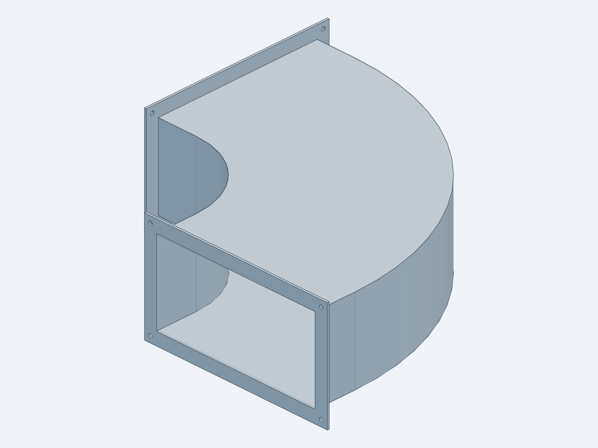
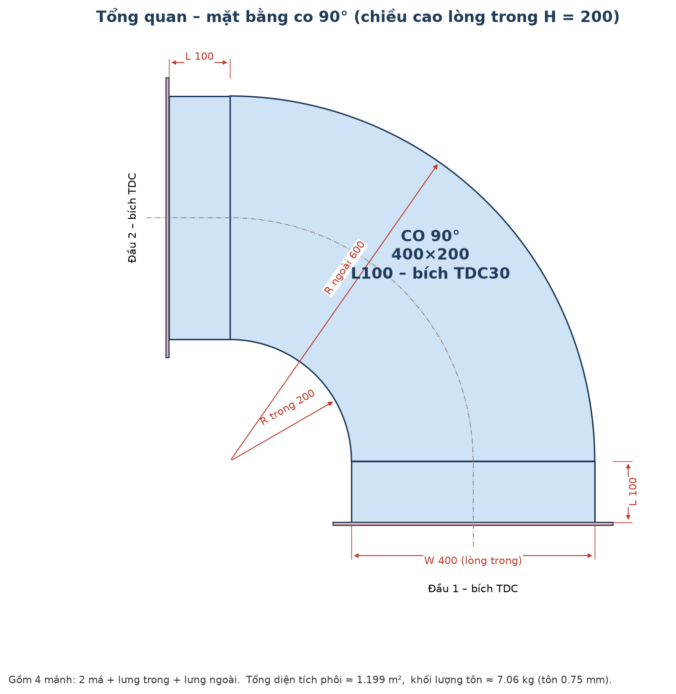
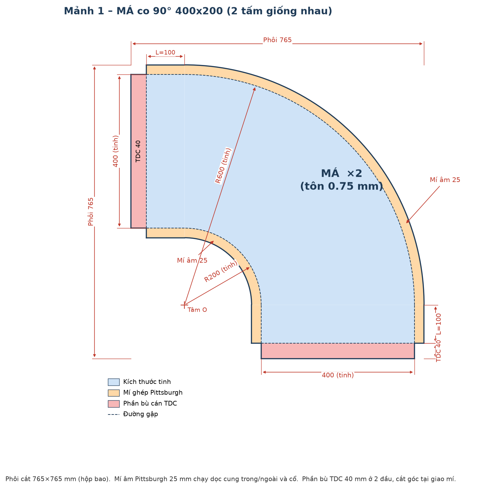
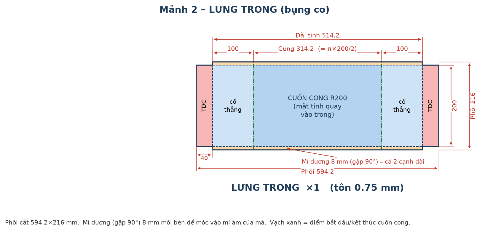
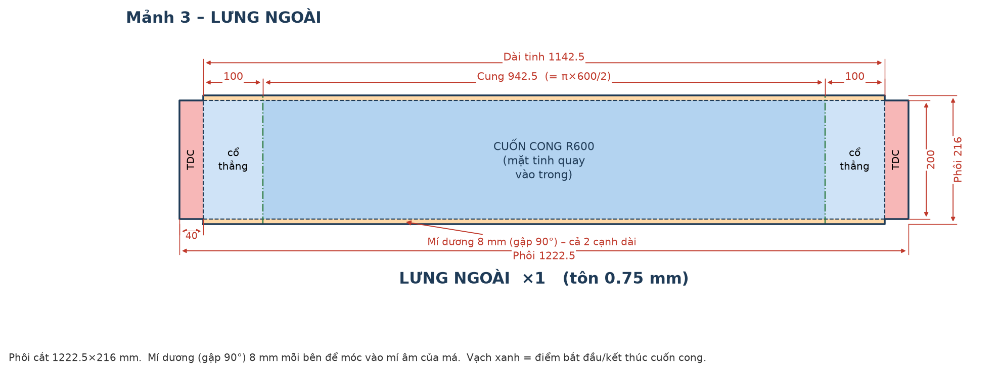
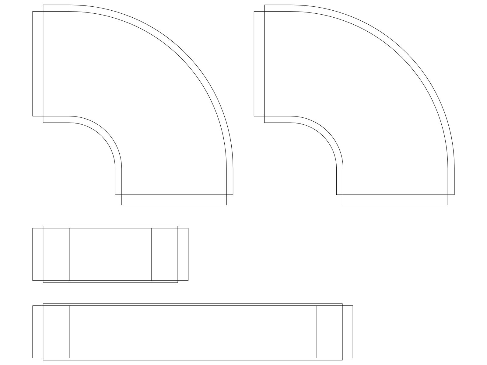
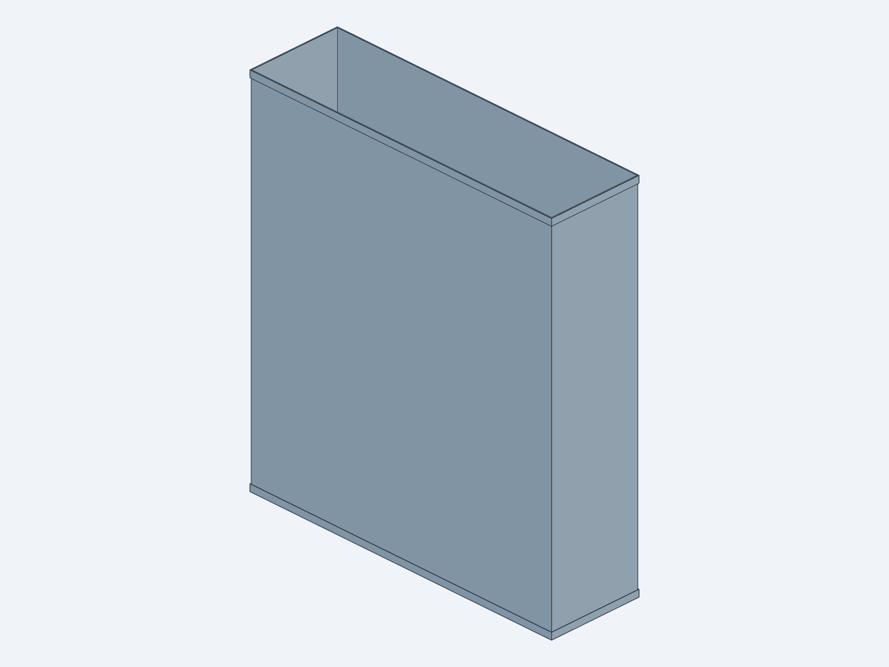

# Ống gió HVAC – Hồ sơ kỹ thuật

Hồ sơ gồm mô hình 3D, bản vẽ phôi cắt và bảng thông số cho các phụ kiện ống gió chữ nhật bằng tôn mạ kẽm.

| # | Hạng mục | Quy cách | Xem 3D trên trình duyệt | File 3D (STEP) |
|---|---|---|---|---|
| 1 | Co 90° | 400×200, cổ L100, bích TDC | [co90_400x200_L100.stl](STL/co90_400x200_L100.stl) | [STEP](STEP/co90_400x200_L100.step) |
| 2 | Ống thẳng | 700×200, L800, nối mí C | [ong_gio_700x200_L800.stl](STL/ong_gio_700x200_L800.stl) | [STEP](STEP/ong_gio_700x200_L800.step) |

> **Mẹo:** bấm vào file `.stl` ở trên để GitHub hiện mô hình 3D, xoay và zoom được ngay trên trình duyệt. File `.step` dùng để mở trong AutoCAD (lệnh `IMPORT`), Inventor, SolidWorks, Revit…

---

## 1. Co 90° 400×200 L100 – bích TDC



### Thông số chung

| Hạng mục | Giá trị |
|---|---|
| Kích thước lòng trong | 400 × 200 mm (400 là cạnh quay) |
| Bán kính | R trong 200 / R ngoài 600 |
| Cổ thẳng mỗi đầu | 100 mm |
| Vật liệu | Tôn mạ kẽm dày 0.75 mm |
| Nối 2 đầu | Bích TDC 30 |
| Ghép má – lưng | Mí Pittsburgh (âm 25 mm trên má / dương 8 mm trên lưng) |

### Bảng thống kê mảnh

| # | Tên mảnh | SL | Kích thước tinh (mm) | Phôi cắt (mm) |
|---|---|---|---|---|
| 1 | Má | 2 | Hình L cong R200–R600, cổ 100, rộng 400 | 765 × 765 |
| 2 | Lưng trong (bụng) | 1 | 514.2 × 200 (100 + cung 314.2 + 100) | 594.2 × 216 |
| 3 | Lưng ngoài | 1 | 1142.5 × 200 (100 + cung 942.5 + 100) | 1222.5 × 216 |

Tổng diện tích phôi ≈ **1.20 m²**, khối lượng tôn ≈ **7.1 kg**.

### Bản vẽ từng mảnh

**Tổng quan mặt bằng**



**Mảnh 1 – Má (×2)**



**Mảnh 2 – Lưng trong**



**Mảnh 3 – Lưng ngoài**



**Sơ đồ phôi cắt (DXF, tỉ lệ 1:1, đơn vị mm)**: [co90_400x200_L100_trai_phang.dxf](DXF/co90_400x200_L100_trai_phang.dxf)



Các lớp trong DXF: `CUT` là đường cắt phôi, `BEND_FOLD` là đường gập mí và gập TDC, `REFERENCE_ROLL` là vạch bắt đầu và kết thúc cuốn cong.

---

## 2. Ống thẳng 700×200 L800 – nối mí C



| Hạng mục | Giá trị |
|---|---|
| Kích thước lòng trong | 700 × 200 mm |
| Chiều dài | 800 mm (tính cả mí) |
| Vật liệu | Tôn mạ kẽm dày 0.75 mm |
| Nối 2 đầu | Mí C: mép gập ngược ra ngoài 180°, dài 15 mm, để đóng nẹp C |
| Khối lượng | ≈ 8.8 kg |

---

## Cấu trúc thư mục

```
STEP/   Mô hình 3D dạng STEP (mở bằng phần mềm CAD)
STL/    Mô hình 3D dạng STL (xem trực tiếp trên GitHub)
DXF/    Bản vẽ phôi cắt 2D
docs/   Ảnh thông số và ảnh 3D
src/    Mã nguồn tham số dựng mô hình (build123d / cadgen)
tools/  Script vẽ ảnh thông số
```

*Phần bù mí và phần bù cán TDC là số tham khảo, có thể điều chỉnh theo thiết bị gia công thực tế.*
